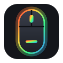
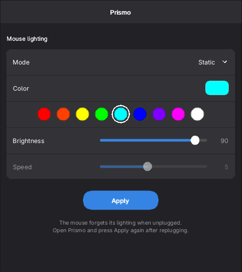
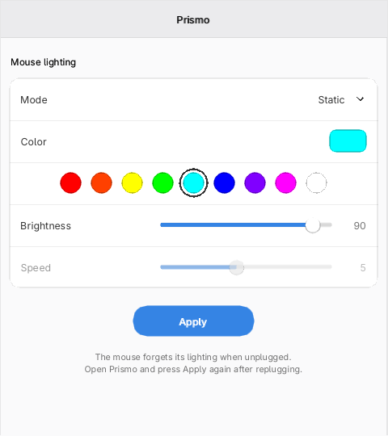
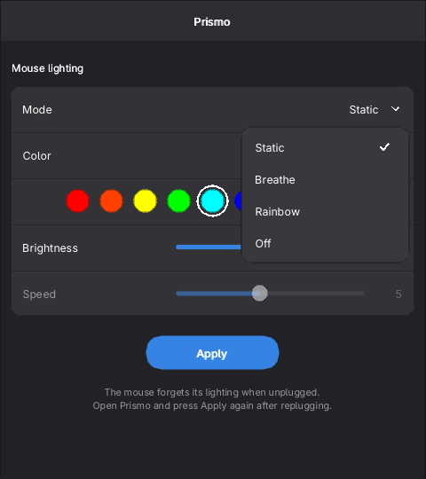
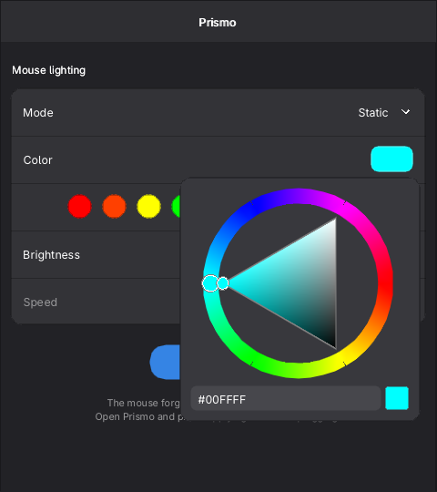

<p align="center">
  
</p>

<h1 align="center">Prismo</h1>

<p align="center">
  RGB lighting control for budget gaming mice built on the <b>N5312A</b> chip.<br>
  One small native app for <b>Windows</b> and <b>Linux</b>. No drivers, no vendor bloatware.
</p>

<p align="center">
  
  &nbsp;
  
</p>

> [!IMPORTANT]
> **Your mouse forgets its lighting when it loses power.** After you unplug it or restart the PC,
> it goes back to its default rainbow breathing. Open Prismo and press **Apply**
> again. Your last settings are saved, so it's one click.
>
> The mouse has no on-board memory for lighting, so no software can make the setting stick.
> The vendor software appears to work the same way: it re-sends the settings when it starts.

> [!NOTE]
> **Right now Prismo supports one mouse: the Ant Esports KM540** (USB ID `4e53:5406`).
> Support for more devices is planned. Contributions are very welcome, especially USB
> captures from other N5312A mice (see [Contributing](#contributing)).

## Features

- **Modes:** Static, Breathe, Rainbow, Off
- **Any color:** full color wheel, hex input, and one-click presets
- **Brightness** (10–100) and **speed** (1–10)
- **Follows your system theme** (light / dark)
- **Single file:** the Windows `.exe` needs nothing installed; the Linux binary only needs SDL3
- Talks to the mouse directly through the OS HID API; no background service

<p align="center">
  
  &nbsp;
  
</p>

## Supported mice

| Mouse | USB ID | Chip | Status |
|---|---|---|---|
| Ant Esports KM540 (mouse from the KM540 combo) | `4e53:5406` | N5312A | ✅ Tested, works |
| Marvo Scorpion M115 | unknown | N5312A ([1], [2]) | ❓ Same chip reported, untested, not detected yet |
| Other "USB OPTICAL MOUSE" devices with vendor `4e53` (e.g. `4e53:5407`) | `4e53:xxxx` | likely N5312A family | ❓ Unverified |

[1]: https://gitlab.com/CalcProgrammer1/OpenRGB/-/work_items/1959
[2]: https://dar-elcomputer.com/products/mouse-marvo-mo536

Prismo currently only looks for `4e53:5406`. If you own one of the other mice and want to help
get it supported, please [open an issue](#contributing).

**How to find your mouse's USB ID**

- **Linux:** `lsusb | grep -i 4e53`
- **Windows:** Device Manager → Mice and other pointing devices → your mouse → Properties →
  Details → *Hardware Ids*. Look for `VID_4E53&PID_5406`.

## Download

Grab the latest build from the [**Releases**](../../releases/latest) page:

| OS | File | Requirements |
|---|---|---|
| Windows 10 / 11 (64-bit) | `Prismo.exe` | None, just double-click it |
| Linux (x86-64) | `prismo` | SDL3 (`sudo pacman -S sdl3`, `sudo apt install libsdl3-0`, `sudo dnf install SDL3`) |

On Linux, make it executable first: `chmod +x prismo && ./prismo`. Your user needs access
to the mouse's `/dev/hidraw*` node, which desktop sessions normally grant automatically.

### Command line

```
prismo --apply    # re-send the saved settings without opening a window
```

Settings are stored in `~/.config/prismo/config.ini` (Linux) or `%APPDATA%\prismo\config.ini` (Windows).

## Building from source

Prismo builds both binaries on Linux. You need `g++`, `pkg-config`, and SDL3. The Windows
build cross-compiles with [Zig](https://ziglang.org/):

```bash
git clone --recursive https://github.com/NXNTSTREAK/prismo.git
cd prismo
python3 -m venv .tools/venv && .tools/venv/bin/pip install ziglang   # only for the Windows build
./build.sh            # both;  ./build.sh linux  or  ./build.sh windows  for one
```

Binaries end up in `dist/`.

| Path | What |
|---|---|
| `src/prismo.cpp` | The lighting protocol and settings file |
| `src/device_linux.cpp`, `src/device_windows.cpp` | Finding the mouse and sending HID feature reports |
| `src/ui.cpp` | The interface (Dear ImGui, styled after GNOME's libadwaita) |
| `src/main_linux.cpp`, `src/main_windows.cpp` | Window setup (SDL3 on Linux, Win32 + Direct3D 11 on Windows) |

## How it works

The mouse exposes a vendor HID collection (usage page `0xFF01`, interface 1). Every command
is an 8-byte **feature report** with report ID `0x07`:

| Bytes | Meaning |
|---|---|
| `07 a0 00 …` | Start / init |
| `07 01 …`, `07 09 …`, `07 08 …` | Fixed setup sequence (replayed as captured) |
| `07 0b <slot> R G B …` | Set color slot 0–3. Static and Breathe use **slot 1** |
| `07 0a <mode> 01 01 01 <speed> <brightness>` | Apply. Mode: `00` rainbow, `01` breathe, `02` static, `03` off. Speed 1–10, brightness 10–100 |

The full sequence is in [`src/prismo.cpp`](src/prismo.cpp).

## Contributing

Contributions are appreciated: bug reports, testing on Windows, new mice, code.

**Adding a mouse.** Open an issue with:

1. The mouse's name and its USB ID (see above).
2. If it comes with lighting software: a USB capture (e.g. [Wireshark](https://www.wireshark.org/) +
   USBPcap on Windows) of the software changing the color and mode.
3. On Linux, the output of `cat /sys/class/hidraw/hidraw*/device/uevent | grep HID_ID`.

Pull requests should keep the app a single dependency-free file on Windows.

## Credits

- Protocol notes and the N5312A identification come from the community capture in
  [OpenRGB issue #1959](https://gitlab.com/CalcProgrammer1/OpenRGB/-/work_items/1959).
- UI: [Dear ImGui](https://github.com/ocornut/imgui) (MIT).
- Font: [Adwaita Sans](https://gitlab.gnome.org/GNOME/adwaita-fonts) (SIL Open Font License 1.1, see `assets/AdwaitaSans-LICENSE.txt`).

Prismo is an independent project and is not affiliated with Ant Esports, Marvo, or the chip maker.

## License

[MIT](LICENSE)
